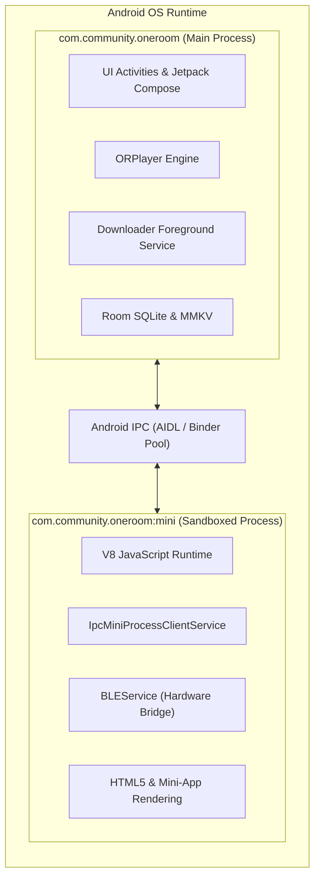
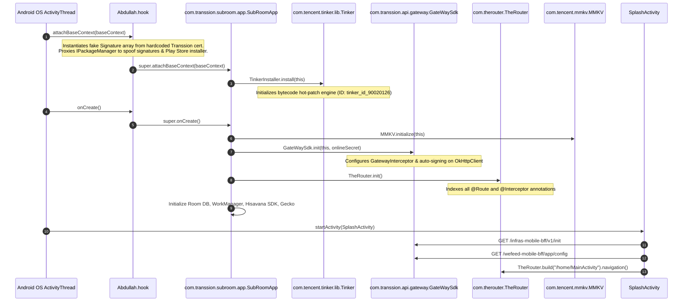

# Volume 1: Application Architecture & Lifecycle

This document provides a deep structural breakdown of the MovieBox / OneRoom application architecture, detailing its runtime process model, component routing, dual presentation frameworks, and initialization lifecycle.

---

## 1. Process Topology & Execution Boundary

MovieBox splits its runtime into two distinct Linux OS processes declared in `AndroidManifest.xml`:



1. **Main Process (`com.community.oneroom`):**
   - Hosts all native UI activities, Jetpack Compose trees, media decoders (`ORPlayer`), the local SQLite/Room database, and the foreground download manager.
   - Runs `com.cloud.tmc.miniapp.ipc.multiprogress.IpcMainProcessClientService` to manage inter-process communication with sandboxed mini-apps.
2. **Mini-App Sandbox Process (`com.community.oneroom:mini`):**
   - Isolated environment running Transsion Mini Cloud (TMC) mini-apps.
   - Houses `com.cloud.tmc.miniapp.ipc.multiprogress.IpcMiniProcessClientService` and `com.cloud.tmc.miniapp.ipc.IpcMiniLauncherService`.
   - Prevents memory leaks or malicious script execution inside third-party mini-programs from crashing the main streaming and playback application.

---

## 2. Technology Stack & Multi-DEX Architecture

The binary compiles 61,981 classes partitioned into 7 DEX files to stay within Dalvik's 65K method reference limitation per index:

| DEX Artifact | Class Count | Primary Package Clusters |
| :--- | :--- | :--- |
| `classes.dex` | 7,616 | Application entry hooks (`Abdullah.hook`), `com.transsion.api.gateway`, `com.transsion.player.orplayer`, `com.transsion.member`, Retrofit core interfaces. |
| `classes2.dex` | 9,764 | Google Play Services (`com.google.android.gms`), Firebase, Google Common utilities. |
| `classes3.dex` | 9,276 | Advertising SDKs: ByteDance Pangle (`com.bytedance.sdk.openadsdk`), Mintegral (`com.mbridge.msdk`), Vungle (`com.vungle.ads`). |
| `classes4.dex` | 9,455 | Transsion Mini Cloud (`com.cloud.tmc`), Web-to-native bridges (`ByteH5Bridge`), Gecko dynamic resource manager. |
| `classes5.dex` | 8,698 | UI View Models, Room database DAOs (`com.transsion.baselib.db`), In-App Billing, and Jetpack Compose runtime. |
| `classes6.dex` | 9,075 | Business logic: `com.transsion.shorttv`, `com.transsion.ugcvideodetail`, `com.transsion.postdetail`, user profiles, search. |
| `classes7.dex` | 8,097 | Jetpack Compose UI (`androidx.compose.ui`), Foundation components, Compose rendering pipeline. |

---

## 3. Application Lifecycle & Initialization Sequence

### 3.1 Bootstrap Execution Path

The execution flow begins in `Abdullah.hook` before delegating to Transsion's core `SubRoomApp`:



### 3.2 Hot-Patching via Tencent Tinker
MovieBox integrates **Tencent Tinker** (`com.tencent.tinker.lib` v1.9.15.2):
- **Tinker ID:** `tinker_id_90020126`
- **Patch Services:**
  - `com.tencent.tinker.lib.service.TinkerPatchService`
  - `com.tencent.tinker.lib.service.DefaultTinkerResultService`
  - `com.transsion.tinker.lib.custom.service.CustomResultService`
- **Mechanism:** Allows Transsion engineers to push differential DEX patches, native library updates, and resource modifications dynamically without requiring full APK downloads from app stores.

---

## 4. UI Architecture: Hybrid Jetpack Compose & ViewBinding

MovieBox uses a dual presentation architecture transitioning from classical Android XML layouts to modern declarative UI:

1. **Jetpack Compose (`androidx.compose`):**
   - Drives new UI surfaces: `MemberPromotionView`, UGC comments sheets, short drama paywall cards, and custom media control overlays.
   - Leverages Compose State management (`remember`, `mutableStateOf`, `collectAsStateWithLifecycle`) bound to Kotlin Coroutines `StateFlow` in ViewModels.
2. **Classical XML & ViewBinding / DataBinding:**
   - Powers legacy core activities: `SplashActivity`, `MainActivity`, `DashDemoActivity`, `CaptureActivity` (barcode scanner).
   - Custom view wrappers encapsulate player surfaces and video list viewholders.

---

## 5. Component Routing Engine: TheRouter

The application uses **TheRouter** (`com.therouter`), an open-source high-performance Android modular routing framework, eliminating compile-time dependencies between functional modules.

### Registered Route Map (Selected Core Paths)

```
/home/MainActivity                     -> Main navigation tab container
/home/category                         -> Movie & TV category grid
/home/playlist                         -> Curated video playlists
/home/movieFilter                      -> Filter by year, region, genre
/movie/detail                          -> Long-form VOD details screen
/movie/staff                           -> Cast and crew biographies
/video/detail                          -> Video player view & playback controls
/shorttv/playlist                      -> ShortTV drama series directory
/shorttv/category                      -> ShortTV genre browser
/shorttv/movieFilter                   -> Short drama filtering
/member/MemberActivity                 -> VIP Membership purchasing portal
/member/MemberFragment                 -> Embedded VIP benefits tab
/member/MemberPremiumFragment          -> Premium subscriber management
/member/point_history                  -> Coin & reward point ledger
/ugc_search/search_manager             -> Global search interface
/ugc_search/search_result              -> Multi-category search results
/web/web                               -> Hybrid webview container
```

---

## 6. Manifest Component Declarations

### 6.1 Activities (Selected Key Entries)
- `com.transsion.subroom.activity.SplashActivity`: Main launcher activity.
- `com.transsion.subroom.activity.MainActivity`: Home container activity.
- `com.transsion.moviedetail.activity.MovieDetailActivity`: Long-form VOD detail.
- `com.transsion.shorttv.ui.activity.ShortTvListActivity`: Short drama vertical feed.
- `com.transsion.member.MemberActivity`: VIP subscription purchase portal.
- `com.transsion.ugcvideodetail.ui.activity.UGCVideoDetailActivity`: UGC video player.
- `com.transsion.publish.ui.activity.PublishActivity`: Creator video upload studio.
- `com.transsion.player.DashDemoActivity`: Debug & adaptive bitrate testing tool.

### 6.2 Services
- `com.transsnet.downloader.core.ForegroundService`: Persistent file download manager.
- `com.transsnet.downloader.guard.DownloadGuardService`: Daemon watchdog preventing process death.
- `com.cloud.tmc.miniapp.ipc.multiprogress.IpcMainProcessClientService`: Mini-app IPC hub.
- `com.transsion.player.mediasession.MediaService`: Media session and background audio controller.
- `com.transsion.push.service.PushJobIntentService`: Transsion proprietary push engine.
- `com.transsion.athena.aidl.AthenaTrackService`: Centralized telemetry data collector.

### 6.3 Content Providers
- `com.therouter.InnerTheRouterContentProvider`: Zero-code initialization provider for TheRouter.
- `com.cloud.hisavana.sdk.database.HisavanaContentProvider`: Ad mediation configuration store.
- `com.transsion.al.ka.AccountSyncContentProvider`: Transsion ID authentication sync provider.
- `com.blankj.utilcode.util.UtilsFileProvider`: Internal file sharing provider.

