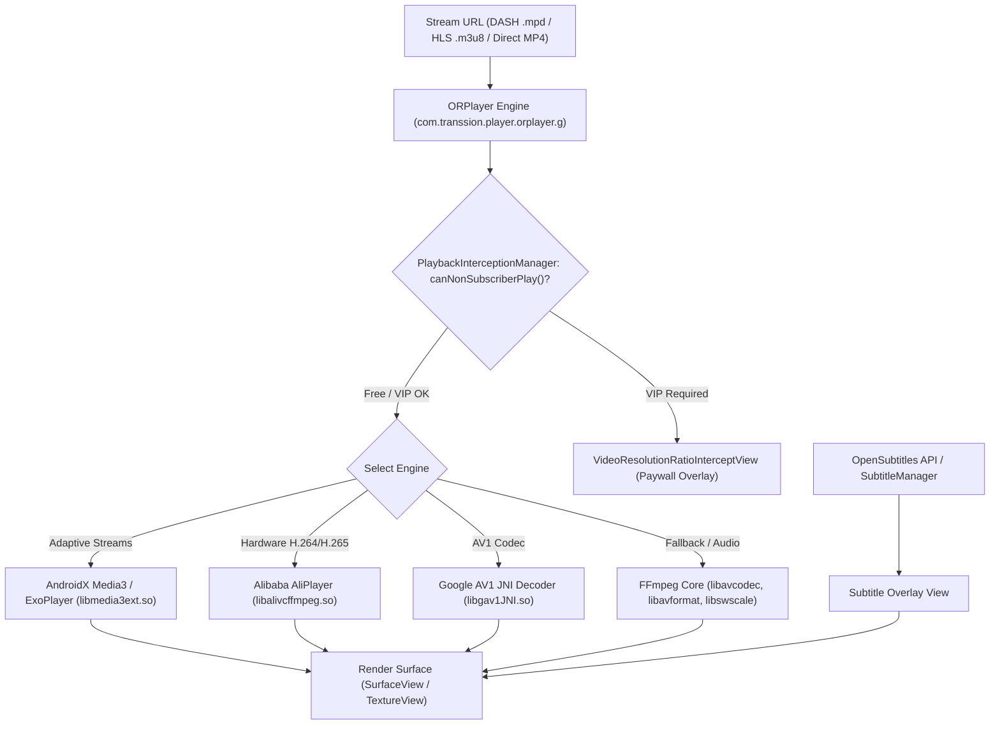
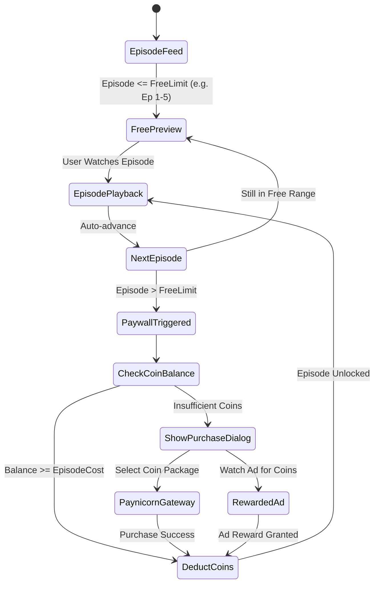
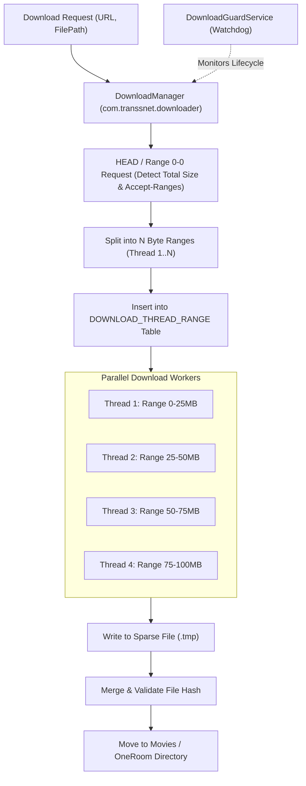

# Volume 2: Core Functional Subsystems

This document reverse-engineers the major functional subsystems of MovieBox / OneRoom, detailing their internal logic, state machines, component interactions, and execution algorithms.

---

## 1. Unified Media Playback Pipeline (`ORPlayer`)

MovieBox implements a custom media playback layer named **ORPlayer** (`com.transsion.player.orplayer`), abstracting multiple hardware and software decoders:

### 1.1 Multi-Engine Architecture
1. **Adaptive Bitrate Streaming (ExoPlayer / Media3):**
   - Implemented via `androidx.media3.exoplayer`. Handles dynamic adaptive streaming over HTTP (DASH with `.mpd` manifests) and HTTP Live Streaming (HLS with `.m3u8` playlists).
   - Dynamic track selection calculates buffer occupancy and network throughput to switch video representations seamlessly.
2. **Alibaba Cloud Player (`libalivcffmpeg.so`):**
   - High-performance player licensed via Alibaba Cloud (`assets/license.crt`, license key: `volXpoYXKsoRJDDPt89df7215938a4eb88c536e67cd49923c`).
   - Optimizes decoding for H.264 and HEVC/H.265 streams on low-end MediaTek and Unisoc processors found in Tecno and Infinix handsets.
3. **Software Decoders:**
   - **Google AV1 (`libgav1JNI.so`):** Enables AV1 decode capabilities on devices lacking dedicated AV1 hardware ASICs.
   - **Custom FFmpeg Libraries:** `libavcodec.so`, `libavformat.so`, `libavutil.so`, `libswresample.so`, `libswscale.so`.

### 1.2 Resolution & Interception Logic (`PlaybackInterceptionManager`)
- The class `com.transsion.player.longvideo.intercept.PlaybackInterceptionManager` monitors playback state.
- Calling `canNonSubscriberPlay(boolean isVip, int currentResolution, int targetResolution, PlayCallback callback)` evaluates stream privileges.
- Standard resolutions (360p, 480p, 720p) bypass paywalls.
- High-definition streams (1080p, 4K) trigger `VideoResolutionRatioInterceptView`, which pauses playback and presents a VIP subscription banner unless overridden by the membership provider.

### 1.3 Subtitle Synchronization Pipeline
- Subtitles are fetched via `SUBTITLE_LANGUAGE_MAP_TABLE` and query `api.opensubtitles.com`.
- Supports external `.srt`, `.vtt`, and embedded CEA-608/708 closed captions.
- Playback synchronization tracks clock offsets in milliseconds to adjust subtitle drift.

---

## 2. ShortTV & Pugc Micro-Drama Subsystem

ShortTV (`com.transsion.shorttv`) represents Transsion's vertical episodic micro-drama platform:

### 2.1 State Management & Monetization
- **Episode Tracking (`SHORT_TV_PLAY` table):** Tracks `subjectId`, `ep` (current episode), `totalEp`, `progress`, `thumbnail`, and `videoId`.
- **Episodic Paywall:**
  - Initial episodes (typically 1 through 5) are designated as free promotional hooks.
  - Subsequent episodes require coins or an active VIP pass.
  - If coin balance is insufficient, `PayLoadingVM` invokes `BasePayLoadingDialog`, allowing users to purchase coins via **Paynicorn** (`api.paynicorn.com`) or **PalmPay** (`com.transsion.fission.FissionProvider`).
- **Binge Play Mode:** A pre-caching mechanism downloads subsequent episode video fragments in the background while the user watches the current episode.

---

## 3. UGC Video Feed & Creator Studio

The user-generated content module (`com.transsion.ugcvideodetail` and `com.transsion.publish`) functions as a short-video social platform:

1. **Infinite Vertical Feed (`UGCVideoDetailActivity`):**
   - Recycles video viewholders using Jetpack Compose and ViewPager2.
   - Pre-warms video players for the next 2 videos in the feed to achieve instant playback on vertical swipe.
2. **Social Interaction Layer:**
   - Real-time comment threads (`/wefeed-mobile-bff/comment/user/list`), user likes, and share triggers.
   - User profile integration (`/wefeed-mobile-bff/user-api/modify`, `/profile/user_profile`).
3. **Creator Studio & S3 Upload Pipeline (`com.transsion.publish`):**
   - Video capture, trimming, filter application, and soundtrack assignment.
   - Direct multipart uploads to **Amazon AWS S3** (`awstransfer` table in SQLite) with background retry logic and progress callbacks.

---

## 4. Multi-Threaded Chunk Downloader (`com.transsnet.downloader`)

To overcome unstable network infrastructure in target markets, Transsion built an industrial-grade chunked range download manager:

### 4.1 Persistence via `DOWNLOAD_THREAD_RANGE`
The SQLite database stores:
- `threadId`: Identifier of the worker thread.
- `rangeId`: Chunk index within the file.
- `start` & `end`: Byte offsets for the HTTP `Range: bytes=start-end` header.
- `progress`: Current committed byte offset.

### 4.2 Guard Daemons
- **`ForegroundService`:** Displays persistent notifications with download speed and completion percentage.
- **`DownloadGuardService`:** An independent Android service acting as a watchdog. If the main activity is garbage collected or destroyed by Android's low-memory killer, the guard service resumes incomplete tasks automatically once resources are available.

---

## 5. Transsion Mini Cloud (TMC) Mini-App Runtime

MovieBox includes a complete mini-program container (`com.cloud.tmc`) running in an isolated `:mini` process:

1. **Execution Engine:**
   - Evaluates mini-apps using Google V8 JavaScript engine and Android System WebView.
   - JSBridge implementation (`assets/ShellJSBridge/byteh5bridge_v240815.aio.min.js` and `assets/WebViewJavascriptBridge.js`) provides two-way asynchronous communication between native Android code and JavaScript.
2. **Native Device APIs Exposed to Mini-Apps:**
   - Network connectivity status, battery level, device orientation.
   - Bluetooth Low Energy (`com.cloud.tmc.miniapp.bluetooth.BLEService`).
   - Camera and barcode scanning (`com.journeyapps.barcodescanner.CaptureActivity`).
   - Local storage and key-value persistence.
3. **OTA Template Delivery via Gecko:**
   - Uses ByteDance Gecko SDK (`com.bytedance.geckox`) to silently fetch updated mini-app bundles and UI templates from `/gecko/server/v3/package`.

---

## 6. Offline P2P Transfer Subsystem (`com.transsion.transfer`)

Recognizing the cost and scarcity of cellular mobile data in emerging regions, MovieBox includes an offline file-sharing subsystem:
- Uses **Wi-Fi Direct (`WifiP2pManager`)** and local Wi-Fi hotspots.
- Allows users to transmit gigabyte-sized downloaded movies and series directly between two devices without utilizing mobile data or an internet gateway.
- Establishes a local HTTP socket server on the sender device, while the receiver device downloads streams directly over high-speed local 5GHz/2.4GHz Wi-Fi links.

