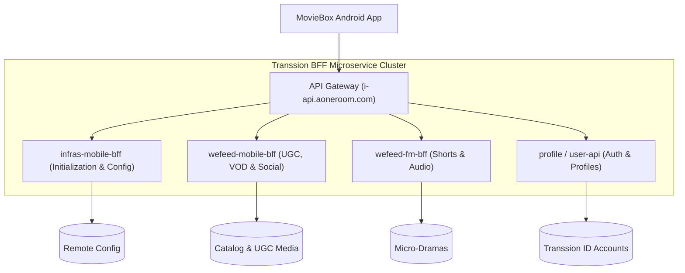

# Volume 3: API Gateway & Networking Specifications

This document details the network architecture, cloud endpoints, microservices BFF design, and the proprietary **Transsion API Gateway HMAC signing algorithm**.

---

## 1. Cloud Infrastructure & Domain Topology

MovieBox connects to a distributed cloud ecosystem operated by Transsion Holdings and Shalltry Group:

| Domain Name | Primary Function |
| :--- | :--- |
| `i-api.aoneroom.com` | Primary OneRoom / MovieBox Core API (catalog, movies, playback credentials, user data). |
| `api.hisavana.com` | Transsion Ad Mediation, experimentation (AB testing), and dynamic feature configuration. |
| `dcdn-api.hisavana.com` | Dynamic CDN load balancer and regional edge routing service. |
| `h5.aoneroom.com` / `h5-static.aoneroom.com` | H5 webview landing pages, promotion banners, and terms of service. |
| `v.aoneroom.com` | Video streaming media CDN origin and chunk distribution. |
| `cloud-config-api.shalltry.com` | Centralized remote app configuration and feature toggles for Transsion apps. |
| `gslb.shalltry.com` | Global Server Load Balancing for selecting lowest-latency regional data centers. |
| `ire-oneid.shalltry.com` | Transsion OneID unified cross-app device fingerprinting service. |
| `api.eagllwin.com` | Material static resources, Mini-App host configuration, and CDN metadata. |
| `api.byte-app.com` | Mini-App code bundle registry and package hosting. |
| `api.paynicorn.com` | Payment gateway for coin purchases, wallet reloads, and subscription billing. |
| `tracking.twibida.com` | Transsion enterprise analytics, event tracking, and telemetry ingestion pipeline. |
| `api.opensubtitles.com` | External subtitle search and multilingual `.srt` subtitle file distribution. |

---

## 2. Microservice BFF (Backend For Frontend) Architecture

MovieBox organizes its APIs into dedicated BFF layers optimized for mobile consumers:



### 2.1 Core BFF Endpoints

#### Initialization & Device Bootstrap
- `POST /infras-mobile-bff/v1/init`: App startup handshake; verifies device fingerprint, retrieves AB test buckets, and synchronizes server timestamps.
- `GET /wefeed-mobile-bff/app/config`: Global client configuration, navigation tab hierarchies (`assets/appTab.json`), and feature toggles.
- `GET /one/v1/odid`: Transsion OneID hardware device identifier generation.

#### Catalog, Playback & Subtitles
- `GET /wefeed-mobile-bff/subject-api/get`: Retrieves long-form movie/series details, seasons, episodes, and stream manifest URLs.
- `GET /wefeed-mobile-bff/subject-api/search/v2`: Search indexing with multi-facet filters.
- `POST /wefeed-mobile-bff/ugc/video/play`: Fetches playback token and CDN stream endpoints for short videos.
- `GET /wefeed-mobile-bff/ugc/video/caption`: Fetches synchronized closed captions and subtitle files.
- `POST /wefeed-mobile-bff/ugc/video/start-download`: Validates download privileges and issues signed chunk URLs.
- `POST /wefeed-mobile-bff/ugc/video/finish-download`: Reports successful offline download completion.

#### ShortTV & Micro-Dramas
- `GET /wefeed-fm-bff/shorts/subject/list`: Catalog of vertical micro-dramas.
- `POST /shorttv/playlist`: Episode list and status (free vs locked) for a given drama series.
- `POST /shorttv/category`: Genre classification and rankings.

#### VIP Membership & Entitlements
- `GET /wefeed-mobile-bff/vip/member/detail`: User subscription tier, expiration timestamp, and privileges.
- `POST /wefeed-mobile-bff/vip/member/rights-check`: Real-time entitlement validation for 1080p/4K playback and ad suppression.
- `POST /wefeed-mobile-bff/vip/member/rewards-receive`: Claims daily check-in rewards and coin grants.

#### Social & Community Interaction
- `GET /wefeed-mobile-bff/comment/user/list`: Hierarchical comment list for videos.
- `GET /wefeed-mobile-bff/post/list/user/my`: User social feed and community posts.
- `POST /wefeed-mobile-bff/feedback/commit`: User feedback, bug reports, and diagnostic logs.

---

## 3. The API Gateway HMAC Request Signing Protocol

To protect backend APIs from scraping, tampering, and unauthorized access, all HTTP requests routed through `com.transsion.api.gateway.GateWaySdk` are automatically signed by `GatewayInterceptor`.

### 3.1 Hardcoded Production Secrets

Extracted directly from `AndroidManifest.xml` meta-data:
- **Online Production Secret:**  
  `76iRl07s0xSN9jqmEWAt79EBJZulIQIsV64FZr2O`
- **Testing Secret:**  
  `Xqn2nnO41/L92o1iuXhSLHTbXvY4Z5ZZ62m8mSLA`

### 3.2 Canonical String Assembly Algorithm

Disassembled from `GatewayInterceptor.doGzipOrSign(Request)`:

```
CanonicalString = 
    Header["accept"] + "\n" +
    Header["content-type"] + "\n" +
    Header["content-length"] + "\n" +
    BodyDigest + "\n" +
    RequestURI.getPath() + "\n" +
    SortedQueryString
```

#### Body Digest Calculation Rules:
1. If the request body is null or empty, `BodyDigest` is an empty string `""`.
2. If the request body size exceeds 102,400 bytes (100 KB):
   - The interceptor reads only the first 102,400 bytes into an Okio buffer.
   - It computes the MD5 digest of this 100 KB slice and formats it as a 32-character lowercase hex string.
3. If the request body is under 102,400 bytes:
   - It computes the MD5 hex digest of the entire body bytes.

### 3.3 Signature Computation

The canonical string is signed using HMAC with the active gateway secret:

$$\text{Digest} = \text{HMAC-SHA256}(\text{Key} = \text{gateway\_secret}, \text{Data} = \text{CanonicalString})$$

### 3.4 Dispatched HTTP Headers

The interceptor attaches two mandatory headers to the outgoing request:

```http
x-tr-signature-method: HmacSHA256
x-tr-signature: <Timestamp>|2|<Hmac_Hex_Digest>
```

Where:
- `<Timestamp>` is the current client Unix epoch time in milliseconds adjusted by `time_offset` (received from prior server responses via `SafeStringUtils`).
- `|2|` represents Protocol Version 2 of the Transsion Gateway signature schema.
- `<Hmac_Hex_Digest>` is the resulting HMAC hex string.

### 3.5 Python Verification Script

```python
import hmac, hashlib, time

def generate_gateway_signature(method, path, query_params, headers, body_bytes, secret):
    # 1. Accept, Content-Type, Content-Length
    accept = headers.get('accept', '')
    content_type = headers.get('content-type', '')
    content_length = str(len(body_bytes)) if body_bytes else ''
    
    # 2. Body MD5
    if not body_bytes:
        body_digest = ''
    else:
        slice_bytes = body_bytes[:102400]
        body_digest = hashlib.md5(slice_bytes).hexdigest()
        
    # 3. Canonical String
    canonical_str = f"{accept}\n{content_type}\n{content_length}\n{body_digest}\n{path}\n{query_params}"
    
    # 4. HMAC-SHA256
    sig_hex = hmac.new(secret.encode('utf-8'), canonical_str.encode('utf-8'), hashlib.sha256).hexdigest()
    timestamp_ms = int(time.time() * 1000)
    
    return {
        "x-tr-signature-method": "HmacSHA256",
        "x-tr-signature": f"{timestamp_ms}|2|{sig_hex}"
    }

# Example usage with online secret
secret = "76iRl07s0xSN9jqmEWAt79EBJZulIQIsV64FZr2O"
headers = generate_gateway_signature("POST", "/wefeed-mobile-bff/app/config", "", {"accept": "application/json"}, b"", secret)
print(headers)
```

