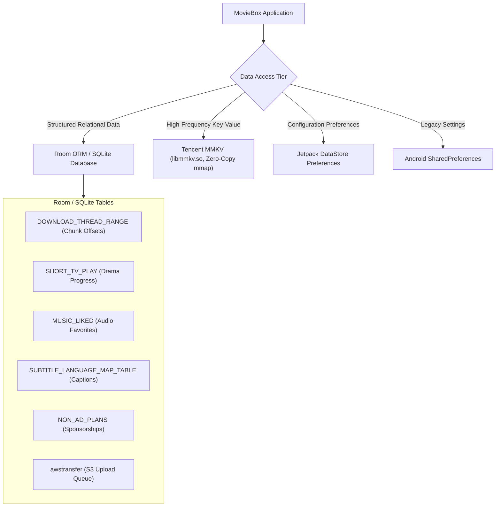

# Volume 4: Local Database & Storage Architecture

This document documents MovieBox's client-side persistence architecture, covering its 148 SQLite/Room tables, MMKV high-performance key-value storage, and Jetpack DataStore preferences.

---

## 1. Storage Architecture Overview

MovieBox employs a multi-tiered local persistence strategy:



---

## 2. Core SQLite & Room Database Schemas

The application defines 148 tables managed through Room ORM DAOs in `com.transsion.baselib.db`. The primary operational schemas include:

### 2.1 Multi-Threaded Download Range (`DOWNLOAD_THREAD_RANGE`)
Tracks chunk offsets for active and paused background downloads:

```sql
CREATE TABLE IF NOT EXISTS DOWNLOAD_THREAD_RANGE (
    threadId INTEGER NOT NULL,
    rangeId INTEGER NOT NULL,
    resourceId TEXT,
    start INTEGER NOT NULL,
    end INTEGER NOT NULL,
    progress INTEGER NOT NULL,
    PRIMARY KEY(threadId, rangeId)
);
```
- `threadId`: Index of the executing worker thread.
- `rangeId`: Sequence index of the byte segment.
- `start` / `end`: Byte boundaries for HTTP range requests (`Range: bytes=start-end`).
- `progress`: High-water mark of received bytes.

### 2.2 ShortTV Playback & Progress (`SHORT_TV_PLAY`)
Maintains playback positions and episode completion status for micro-dramas:

```sql
CREATE TABLE IF NOT EXISTS SHORT_TV_PLAY (
    subjectId TEXT NOT NULL,
    id TEXT NOT NULL,
    ep INTEGER NOT NULL,
    se INTEGER NOT NULL,
    totalEp INTEGER NOT NULL,
    progress INTEGER NOT NULL,
    title TEXT,
    description TEXT,
    coverUrl TEXT,
    thumbnail TEXT,
    videoId TEXT,
    videoUrl TEXT,
    timeStamp INTEGER NOT NULL DEFAULT 0,
    PRIMARY KEY(subjectId, id)
);
```

### 2.3 Audio Favorites (`MUSIC_LIKED`)
Maintains user-curated music and soundtrack bookmarks:

```sql
CREATE TABLE IF NOT EXISTS MUSIC_LIKED (
    subjectId TEXT NOT NULL,
    title TEXT,
    coverUrl TEXT,
    countryName TEXT,
    genre TEXT,
    releaseDate TEXT,
    durationSeconds INTEGER NOT NULL DEFAULT 0,
    singerName TEXT,
    singerAvatar TEXT,
    path TEXT,
    timeStamp INTEGER NOT NULL DEFAULT 0,
    PRIMARY KEY(subjectId)
);
```

### 2.4 Subtitle Language Mapping (`SUBTITLE_LANGUAGE_MAP_TABLE`)
Maps ISO language codes to UI display names and OpenSubtitles query keys:

```sql
CREATE TABLE IF NOT EXISTS SUBTITLE_LANGUAGE_MAP_TABLE (
    lan TEXT NOT NULL,
    lanName TEXT NOT NULL,
    inSearch INTEGER NOT NULL,
    PRIMARY KEY(lan)
);
```

### 2.5 Non-Ad Direct Sponsorships (`NON_AD_PLANS`)
Controls direct brand sponsorships and promotional campaigns that bypass standard ad networks:

```sql
CREATE TABLE IF NOT EXISTS NON_AD_PLANS (
    id TEXT NOT NULL,
    version TEXT,
    name TEXT,
    startTime TEXT,
    endTime TEXT,
    extraConfig TEXT,
    displayTimes INTEGER,
    showedTimes INTEGER,
    showDate TEXT,
    advertiserName TEXT,
    advertiserAvatar TEXT,
    advertiserAvatarPath TEXT,
    brand TEXT,
    PRIMARY KEY(id)
);
```

### 2.6 S3 Creator Video Upload Queue (`awstransfer`)
Tracks multipart uploads of creator videos to Amazon S3:

```sql
CREATE TABLE IF NOT EXISTS awstransfer (
    _id INTEGER PRIMARY KEY AUTOINCREMENT,
    main_upload_id INTEGER,
    type TEXT NOT NULL,
    state TEXT NOT NULL,
    bucket_name TEXT NOT NULL,
    key TEXT NOT NULL,
    version_id TEXT,
    bytes_total BIGINT,
    bytes_current BIGINT,
    speed BIGINT,
    is_requester_pays INTEGER,
    is_encrypted INTEGER,
    file_path TEXT NOT NULL
);
```

### 2.7 In-App Coin & Currency Consumption (`CONSUME_BEAN`)
Tracks local coin deductions for drama episode unlocks prior to cloud sync:

```sql
CREATE TABLE IF NOT EXISTS CONSUME_BEAN (
    id INTEGER PRIMARY KEY AUTOINCREMENT NOT NULL,
    updateTimeStamp INTEGER NOT NULL,
    dataType INTEGER NOT NULL,
    appVersion INTEGER NOT NULL,
    consumeJson TEXT
);
```

### 2.8 Geolocation & SIM Country Mapping (`LOCAL_MCC`)
Maps Mobile Country Codes from the user's SIM card to regional feature policies:

```sql
CREATE TABLE IF NOT EXISTS LOCAL_MCC (
    id INTEGER PRIMARY KEY AUTOINCREMENT NOT NULL,
    Country TEXT NOT NULL,
    Mcc TEXT NOT NULL,
    Iso TEXT NOT NULL,
    CountryCode TEXT NOT NULL
);
```

---

## 3. High-Performance Key-Value Storage (MMKV)

MovieBox embeds **Tencent MMKV** (`lib/arm64-v8a/libmmkv.so`), a zero-copy POSIX `mmap`-backed key-value store used where SQLite overhead is undesirable:

1. **User Membership & Privileges:**
   - `kv_is_enable_member`: Boolean flag for membership feature enablement.
   - `kv_is_pay_enable_member`: Controls payment gateway visibility.
2. **Gateway Synchronization:**
   - `time_offset`: Server-to-client clock offset in milliseconds used by `GatewayInterceptor`.
   - `gateway_token`: User authentication session token.
3. **Player Preferences:**
   - Default resolution index (Auto, 360p, 480p, 720p, 1080p).
   - Audio track language and default subtitle toggle.

---

## 4. Jetpack DataStore Preferences

Used for structured, asynchronous key-value persistence:
- Stored in `shared_prefs/` and `datastore/` directories under private application storage.
- Synchronized with `libdatastore_shared_counter.so` to maintain thread-safe and process-safe atomic counters between the main application and background worker tasks.

