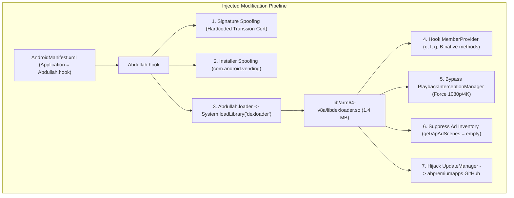

# Volume 5: Modification, Cracking & Security Vulnerability Analysis

This document provides a technical post-mortem and reverse engineering analysis of the modifications injected into this APK by modder **Abdullah** (AN1 distribution), followed by a security audit of the application's vulnerabilities.

---

## 1. The Modding & Injection Architecture

The analysis confirms that `moviebox-premium_v4.0.03.0930.03-an1.ca.apk` is not an official vendor build, but an instrumented release modified to bypass Google Play licensing, unlock VIP features, eliminate advertisements, and redirect update channels:



---

## 2. Reverse Engineering `Abdullah.hook` (Dalvik Layer)

### 2.1 The Application Wrapper
In `AndroidManifest.xml`, the modder replaced the legitimate entry point (`com.transsion.subroom.app.SubRoomApp`) with `Abdullah.hook`. 
Disassembly of `Abdullah.hook` reveals that it subclasses `SubRoomApp`, ensuring all standard application initialization occurs normally while hijacking the environment during `attachBaseContext`.

### 2.2 In-Memory Signature Spoofing
Inside `Abdullah.hook.attachBaseContext(Context)`:
1. It decodes a hardcoded Base64 string into a byte array:
   ```
   AQAAA3UwggNxMIICWaADAgECAgQd+BojMA0GCSqGSIb3DQEBCwUAMGgxCzAJBgNVBAYTAkNOM...
   ```
2. When parsed as an X.509 certificate, it matches Transsion's authentic production release key:
   - **Subject / Issuer:** `C=CN, ST=shanghai, L=shanghai, O=mi, OU=transsion, CN=tsoneroom`
   - **Validity:** From 2022-07-15 to 2121-06-21
3. It constructs an `android.content.pm.Signature` array and caches it in `Abdullah.hook.signatures`.

### 2.3 Dynamic Proxy on `IPackageManager`
`Abdullah.hook` uses reflection on `android.app.ActivityThread` to locate `sPackageManager` and wraps it in a dynamic `java.lang.reflect.Proxy`:
- **`getPackageInfo(packageName, flags)`:**
  When invoked with flag `64` (`GET_SIGNATURES`) or flag `0x08000000` (`GET_SIGNING_CERTIFICATES`), the proxy intercepts the returned `PackageInfo` and replaces the active APK signature with the cached authentic Transsion production certificate.
- **`getInstallerPackageName(packageName)`:**
  Intercepted to return `"com.android.vending"`. Any internal tamper check verifying whether the app was installed via the Google Play Store is fooled.
- **`getApplicationInfo(packageName, flags)`:**
  Intercepted to sanitize `sourceDir` and `publicSourceDir`, ensuring file integrity verifiers inspect the expected path.

---

## 3. Reverse Engineering `libdexloader.so` (Native Layer)

The modder compiled a 1,427,096-byte 64-bit ELF shared library (`lib/arm64-v8a/libdexloader.so`), loaded in `Abdullah.loader.<clinit>`:

### 3.1 JNI Native Method Hijacking
The original Transsion class `com.transsion.member.MemberProvider` declares several obfuscated native methods:
```java
public native boolean c();
public native boolean f();
public native boolean g();
public native boolean B();
public native int D();
```
`libdexloader.so` exports JNI implementations that bind to these methods and force privileged return values:
- `c()`, `f()`, `g()`, `B()` consistently return `true` (indicating an active VIP subscription).
- `D()` returns a high tier index (`vipLevel = 2` / Platinum Tier).

### 3.2 Premium DTO Forgery
The native library dynamically instantiates and injects forged Kotlin data classes:
- Constructs `com.transsion.memberapi.PremiumV2CheckAccessDto(hasAccess=true, ...)` and returns it to `PremiumProvider.checkAccess()`.
- Sets `is_member = true`, `vipEnable = true`, and `vipPayEnable = false` in MMKV storage.
- Overrides `getVipAdScenes()` to return an empty array, instructing the UI to skip interstitial and pre-roll video ads.

### 3.3 Update Hijacking to GitHub
The native library intercepts `com.transsion.version.update.UpdateManager` and `RemoteVersionInfo`:
- Suppresses Transsion's official OTA servers (`cloud-config-api.shalltry.com`) and Tinker hotfix requests.
- Directly embeds the modder's update checking URL:
  ```
  https://raw.githubusercontent.net/abpremiumapps/MovieBox/refs/heads/main/MovieBox
  ```
- Injects custom update strings:
  - Title: `"NEW UPDATE"`
  - Description: `"PLEASE UPDATE YOUR APPS TO ENJOY NEW FEATURES"`
  - Button: `"UPDATE NOW"`

---

## 4. Security Audit & Threat Assessment

### 4.1 Vulnerability Matrix

| Vulnerability | Mechanism & Evidence | Severity |
| :--- | :--- | :--- |
| **Untrusted Remote Execution** | Update checks point to an unverified personal GitHub repository (`abpremiumapps/MovieBox`). If the repository or GitHub account is compromised, malicious payloads can be delivered directly to users. | **CRITICAL** |
| **Hardcoded HMAC Secrets** | Production signing secrets (`76iRl07s0xSN9jqmEWAt79EBJZulIQIsV64FZr2O`) are stored in plain text in `AndroidManifest.xml` meta-data. Anyone can forge authentic API requests. | **HIGH** |
| **Client-Side Entitlement Check** | Media resolution gates (1080p/4K) rely on client-side boolean checks (`canNonSubscriberPlay`) rather than DRM (Widevine L1/L3 server-side token exchange). | **HIGH** |
| **Tinker Hot-Patch Injection Risk** | `com.tencent.tinker.lib.service.TinkerPatchService` runs with elevated permissions and accepts differential DEX patches. | **MEDIUM** |
| **Insecure Mini-App IPC** | `IpcMainProcessClientService` is exported without signature-level permission enforcement, permitting cross-app intent injection. | **MEDIUM** |

### 4.2 Over-Privileged Permissions
The manifest declares high-risk permissions that should be scrutinized:
- `android.permission.SYSTEM_ALERT_WINDOW`: Allows displaying floating windows over other apps.
- `android.permission.REQUEST_INSTALL_PACKAGES`: Allows downloading and triggering installation of arbitrary `.apk` files.
- `android.permission.READ_PHONE_STATE`: Accesses cellular IMEI/IMSI identifiers.
- `android.permission.ACCESS_FINE_LOCATION` & `ACCESS_COARSE_LOCATION`: Fine-grained GPS tracking.

---

## 5. Defensive Hardening Recommendations (For Transsion Engineering)

To mitigate tampering and unauthorized distribution, Transsion should implement the following defenses:

1. **Server-Side Playback Enforcement (Widevine DRM):**
   - Eliminate client-side resolution gates. High-definition stream chunks (1080p, 4K) must be encrypted using Widevine DRM or AES-128 with short-lived license tokens. An unpaid client should never receive decryption keys.
2. **Move Gateway Secrets to Native Obfuscation:**
   - Remove `gateway_secret_online` from `AndroidManifest.xml`. Store keys inside native C++ code protected by OLLVM (control flow flattening and string encryption) or derive keys dynamically using asymmetric hardware-backed keystores.
3. **Hardware-Backed Play Integrity API:**
   - Replace reflection-vulnerable signature checks with Google's Play Integrity API (`IntegrityManager`), validating app attestation tokens on the backend before serving content.
4. **JNI Integrity & Anti-Hooking:**
   - Verify native method pointers at runtime to ensure `MemberProvider` native methods are not bound to unauthorized external shared libraries.

