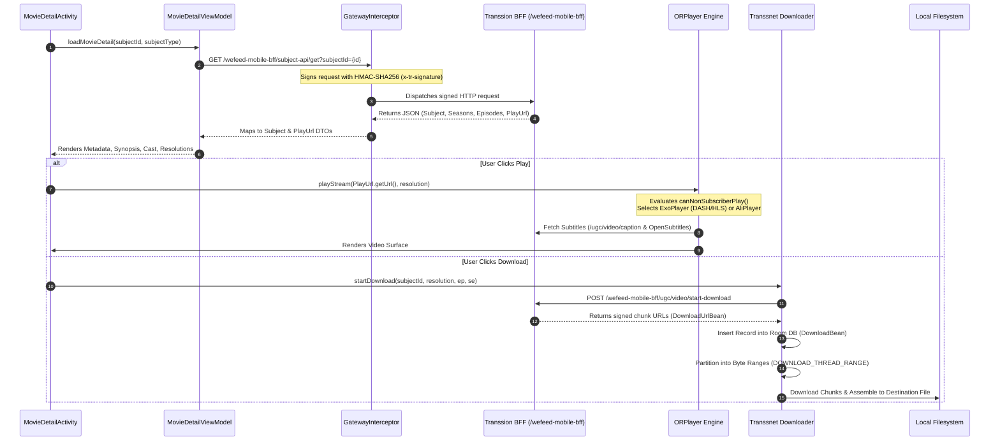
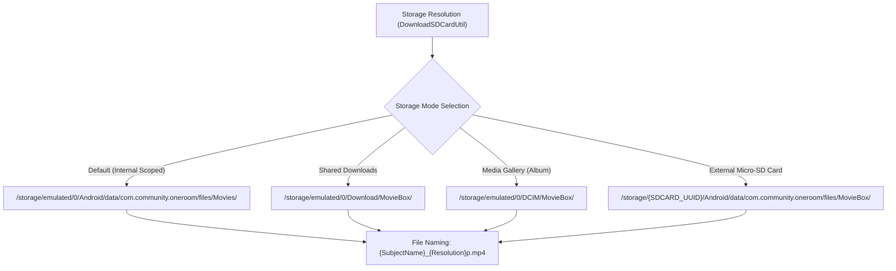

# Volume 6: Movie Fetching Logic & Local Storage Specifications

This document provides a technical analysis of how MovieBox / OneRoom fetches movie metadata, resolves streaming and download URLs, and stores media files on the Android filesystem.

---

## 1. End-to-End Movie Fetching Flow

---

## 2. API Endpoints & Data Model Schema

### 2.1 Metadata & Stream Fetching Endpoints
All movie retrieval queries flow through Transsion's Mobile BFF (`https://i-api.aoneroom.com` / `https://api.hisavana.com`):

1. **Movie/Series Information:**  
   `GET /wefeed-mobile-bff/subject-api/get`
   - **Query Parameters:** `subjectId`, `subjectType` (`1` = Movie, `2` = TV Series, `3` = ShortTV Drama), `language`, `country`.
   - **Authentication:** Signed with `x-tr-signature: <timestamp>|2|<hmac_sha256>`.
2. **Stream URL Resolution:**  
   `POST /wefeed-mobile-bff/ugc/video/play`
   - Returns temporary tokenized CDN playback URLs.
3. **Subtitle Track Fetching:**  
   `GET /wefeed-mobile-bff/ugc/video/caption` & `api.opensubtitles.com`
   - Fetches synchronized `.srt` or `.vtt` text streams for the selected audio language.

### 2.2 Core Media DTOs (Data Transfer Objects)
Extracted from `com.transsion.moviedetailapi.bean`:

* **`Subject` (`com.transsion.moviedetailapi.bean.Subject`):**
  - `subjectId`: Unique alphanumeric movie identifier.
  - `subjectType`: Media classification (`MOVIE`, `TV`, `SHORT_TV`).
  - `title` / `subjectName`: Movie title.
  - `cover`: Primary poster asset URL.
  - `genre`, `releaseDate`, `countryName`, `imdbRate`.
  - `seNum`: Number of available seasons.
  - `playUrl`: Direct reference to `PlayUrl` container.
* **`PlayUrl` (`com.transsion.moviedetailapi.bean.PlayUrl`):**
  - `url`: Direct CDN streaming link (DASH `.mpd`, HLS `.m3u8`, or progressive `.mp4`).
  - `definition`: Integer resolution code (`360`, `480`, `720`, `1080`, `2160`).
  - `bitrate`: Video bitrate in bps.
  - `fps`: Target frame rate.
  - `width` & `height`: Pixel dimensions.
  - `size`: Total stream byte length.

---

## 3. Where Movies Are Stored on Disk

MovieBox stores downloaded video files across three primary storage tiers, resolved by `DownloadSDCardUtil` and `DownloadUtil`:

### 3.1 Absolute Storage Paths

| Storage Tier | Absolute Filesystem Directory | Access Characteristics |
| :--- | :--- | :--- |
| **App-Specific Scoped Storage (Default)** | `/storage/emulated/0/Android/data/com.community.oneroom/files/Movies/` | Default location on Android 10+ (API 29–35). Hidden from system gallery apps; deleted automatically if the app is uninstalled. |
| **Public Shared Downloads** | `/storage/emulated/0/Download/MovieBox/` | Configured via `Llj/b;->c`. Accessible by user-facing file managers; persists after app uninstallation. |
| **Media / DCIM Gallery** | `/storage/emulated/0/DCIM/MovieBox/` | Configured via `Llj/b;->b` and `Llj/b;->d`. Indexed by Android `MediaScanner` for gallery and video player visibility. |
| **External Removable SD Card** | `/storage/<SDCARD_UUID>/Android/data/com.community.oneroom/files/MovieBox/` | Discovered dynamically via `android.os.storage.StorageManager.getStorageVolumes()`. |

### 3.2 File Naming Conventions & Partials
1. **Completed Video Files:**
   - Single Movies: `<MovieTitle>_<Resolution>p.<ext>` (e.g. `Inception_1080p.mp4`).
   - Series / Dramas: `<SeriesTitle>_S<Season>E<Episode>_<Resolution>p.<ext>` (e.g. `ShortDrama_S01E03_720p.mp4`).
   - Duplicate Handling: If a file exists, `DownloadUtil.u(String)` appends incremental numeric suffixes: `<Title>_<Resolution>p_1.mp4`.
2. **In-Progress Temporary Files:**
   - While downloading, chunks are written to sparse files with `.tmp` or `.download` extensions.
   - Once all byte ranges in `DOWNLOAD_THREAD_RANGE` are verified, the file is renamed atomically to its final `.mp4` extension.

---

## 4. Local Database Tracking

Downloaded content is cataloged locally in two Room SQLite tables:

1. **`DownloadBean` (`com.transsion.baselib.db.download.DownloadBean`):**
   - `path`: Full absolute path on disk (e.g. `/storage/emulated/0/Download/MovieBox/Movie_720p.mp4`).
   - `rootPath`: Target base directory.
   - `rootPathType`: `PATH_TYPE_ALBUM` (`0`), `PATH_TYPE_BM_INNER` (`1`), `PATH_TYPE_SDCARD` (`2`).
   - `url` & `sourceUrl`: Remote origin URLs.
   - `resolution`: Integer resolution (`720`, `1080`).
   - `status`: `STATUS_DOWNLOADING` (`1`), `STATUS_COMPLETED` (`2`), `STATUS_PAUSED` (`3`), `STATUS_ERROR` (`4`).
2. **`DOWNLOAD_THREAD_RANGE`:**
   - Tracks real-time byte completion offsets (`start`, `end`, `progress`) per chunk worker thread to support instant resume across network disconnects.

