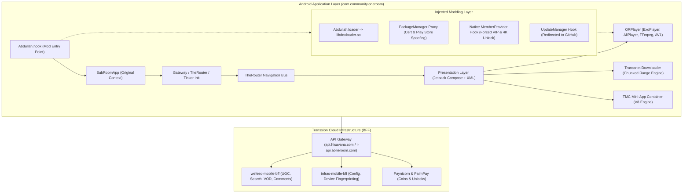

# 🎬 MovieBox (OneRoom) Reverse Engineering Dossier & AetherStream Platform

[](#-forensic-documentation-index)
[](#-aetherstream-reference-implementation)
[](#-aetherstream-reference-implementation)
[](#-aetherstream-reference-implementation)
[](#volume-3-api-gateway--networking-specifications)
[](#-ethical-research--educational-disclaimer)

A comprehensive, multi-volume forensic reverse engineering analysis of Transsion Holdings' flagship entertainment application **MovieBox / OneRoom** (`com.community.oneroom`), paired with **AetherStream**—a full-stack modern reference streaming application implementing the discovered architecture, HMAC gateway protocol, and adaptive media delivery.

---

## 📑 Table of Contents

- [Executive Summary](#-executive-summary)
- [Target Artifact & Forensic Metadata](#-target-artifact--forensic-metadata)
- [High-Level System Topology](#-high-level-system-topology)
- [Forensic Documentation Index](#-forensic-documentation-index)
  - [Volume 1: Application Architecture & Decoupling](#volume-1-application-architecture)
  - [Volume 2: Core Functional Subsystems](#volume-2-core-functional-subsystems)
  - [Volume 3: API Gateway & HMAC Networking](#volume-3-api-gateway--networking-specifications)
  - [Volume 4: Database & Offline Storage Engine](#volume-4-database-and-storage-specifications)
  - [Volume 5: Security, Modding & Hook Analysis](#volume-5-modification-and-security-analysis)
  - [Volume 6: Movie Fetching & Storage Specification](#volume-6-movie-fetching-logic--local-storage-specifications)
- [AetherStream: Reference Implementation](#-aetherstream-reference-implementation)
  - [Architecture & Key Features](#core-highlights)
  - [Quick Start Guide](#running-aetherstream-locally)
- [Repository Directory Structure](#-repository-structure)
- [Ethical Research & Disclaimer](#-ethical-research--educational-disclaimer)

---

## 🔍 Executive Summary

**MovieBox** (internally branded as **OneRoom** / **SubRoom**) is Transsion Holdings' premier digital content ecosystem, powering millions of devices across Africa and South Asia via Tecno, Infinix, and Itel mobile ecosystems. The client features an all-in-one entertainment topology incorporating:

1. **Long-Form VOD Streaming:** Multi-bitrate adaptive DASH/HLS streaming, multi-track audio switching, and multilingual synchronized captions via OpenSubtitles.
2. **ShortTV Micro-Dramas:** Vertical 1-to-2 minute episodic drama delivery with paywall state machines and coin balances.
3. **UGC Social Feed:** High-throughput vertical video carousel with live comments, social interaction, and direct AWS S3 multi-part creator uploading.
4. **Resilient Downloader & P2P Sharing:** Industrial-grade multi-threaded chunked byte-range downloader backed by persistent watchdog daemons and local Wi-Fi Direct peer transfer.
5. **Transsion Mini Cloud (TMC):** V8-driven isolated sandboxed mini-app runtime utilizing high-speed JSB bridges.
6. **Modding & Injection Layer:** Complete analysis of runtime signature spoofing (`Abdullah.hook`), dynamic `IPackageManager` reflection, native VIP enforcement (`libdexloader.so`), and update redirection.

---

## 📊 Target Artifact & Forensic Metadata

| Parameter | Specification |
| :--- | :--- |
| **Artifact Name** | `moviebox-premium_v4.0.03.0930.03-an1.ca.apk` |
| **Package Identifier** | `com.community.oneroom` |
| **Application Title** | MovieBox / OneRoom (Transsion SubRoom) |
| **Version & Build** | `v4.0.03.0930.03` (Build `50020132`) |
| **Target Platform** | Android (Min SDK: `23` / Android 6.0, Target SDK: `35` / Android 15) |
| **Target Architecture** | ARM64-v8a (`arm64-v8a`) + ARMv7 (`armeabi-v7a`) |
| **Total Bytecode Classes** | **61,981 classes** partitioned across 7 DEX files |
| **Reconstructed Sources** | **32,549 Java files** (99.95% decompilation fidelity) |
| **Vendor Ecosystem** | Transsion Holdings (Transsnet Media / Shalltry Group) |
| **Core Video Engine** | AndroidX Media3 / ExoPlayer + Alibaba Cloud AliPlayer + Google AV1 JNI |

---

## 🏛️ High-Level System Topology



---

## 📚 Forensic Documentation Index

The technical findings are detailed across 6 modular specifications:

### [Volume 1: Application Architecture](01_APPLICATION_ARCHITECTURE.md)
* **Entry Points & Lifecycle:** Detailed trace of initial bootstrap sequence through `SubRoomApp` and dynamic provider orchestration.
* **Dual Presentation Layer:** Jetpack Compose interoperability alongside legacy XML ViewBinding.
* **Component Decoupling:** Event-driven navigation bus implemented via **TheRouter**.
* **Process Isolation:** Memory boundaries separating the `:main` application and `:mini` mini-app sandbox processes.

### [Volume 2: Core Functional Subsystems](02_CORE_SUBSYSTEMS.md)
* **Unified Player Architecture (`ORPlayer`):** Multi-engine media switching logic selecting AndroidX Media3 (DASH/HLS), Alibaba Cloud AliPlayer (HEVC/H.264), and Google AV1 software decoders.
* **ShortTV Micro-Drama State Machine:** Episodic paywalls, coin balance checking, and automatic binge pre-caching.
* **UGC Social Pipeline:** Jetpack Compose vertical feed recycling, infinite scrolling, and multi-part AWS S3 upload pipeline.
* **Downloader Engine (`com.transsnet.downloader`):** Chunked HTTP range partitioning (`DOWNLOAD_THREAD_RANGE`) with autonomous `DownloadGuardService` background watchdogs.

### [Volume 3: API Gateway & Networking Specifications](03_API_GATEWAY_AND_NETWORKING.md)
* **Domain Topology:** Detailed role mapping for `i-api.aoneroom.com`, `v.aoneroom.com` (video CDN origin), `hisavana.com`, and `shalltry.com`.
* **Transsion HMAC-SHA256 Protocol:** Complete reverse engineering of `GatewayInterceptor.doGzipOrSign()`.
* **Canonical Assembly Algorithm:** Exact formatting of HTTP Accept, Content-Type, Content-Length, MD5 body slices, and sorted query parameters.
* **Extracted Production Secrets:** Online production signing secrets verified from manifest metadata.

### [Volume 4: Database and Storage Specifications](04_DATABASE_AND_STORAGE.md)
* **Room SQLite ORM:** Schemas for 148 mapped relational tables (`DOWNLOAD_THREAD_RANGE`, `SHORT_TV_PLAY`, `MUSIC_LIKED`, etc.).
* **Zero-Copy Persistence:** Tencent MMKV memory-mapped storage and Jetpack DataStore implementation.

### [Volume 5: Modification and Security Analysis](05_MODIFICATION_AND_SECURITY_ANALYSIS.md)
* **Mod Entry-Point Injection:** Dalvik bytecode analysis of `Abdullah.hook`.
* **Runtime Dynamic Proxy:** In-memory reflection spoofing `IPackageManager` installer origins and signing certificates.
* **Native Hooking (`libdexloader.so`):** Disassembly of JNI hooks forcing VIP status and unlocking 4K UHD resolutions.
* **Update Hijacking:** Analysis of patched version-check endpoints redirecting to an unauthorized GitHub repository.

### [Volume 6: Movie Fetching Logic & Local Storage Specifications](06_MOVIE_FETCHING_AND_STORAGE_SPEC.md)
* **End-to-End Resolution Sequence:** Step-by-step trace from title selection to signed stream URL retrieval.
* **Storage Tier Hierarchy:** Android Scoped Storage (`Android/data/...`), public Downloads, Media Gallery (DCIM), and removable Micro-SD card resolution.

---

## ⚡ AetherStream: Reference Implementation

Located in the [`aether-stream/`](aether-stream/) directory is a modern, production-grade streaming application created to validate and demonstrate the reverse-engineered architectural models.

```
aether-stream/
├── server/
│   ├── index.js             # Express API server (catalog, user library, gateway signer)
│   ├── gatewaySigner.js     # Transsion HMAC-SHA256 Canonical String & signature builder
│   ├── liveCatalog.js       # Live TMDB week trending catalog sync with video keys
│   ├── catalogData.js       # Curated 4K Cinema, Multi-season Series & Micro-Dramas
│   └── data/library.json    # Persistent user watchlist, continue-watching progress & history
└── src/
    ├── components/
    │   ├── PlayerModal.jsx     # Custom HLS.js video player with quality & subtitle switching
    │   ├── GatewayDebugger.jsx # Interactive forensic Transsion API signing inspector
    │   ├── Navbar.jsx          # Instant search, category filters, and library pills
    │   ├── HeroBanner.jsx      # Cinematic featured spotlight carousel
    │   ├── ContentModal.jsx    # Episodic season picker and detailed metadata modal
    │   ├── ExploreView.jsx     # Multi-facet filterable catalog grid
    │   └── LibraryView.jsx     # Watchlist, continue watching, and watch history
    └── App.jsx                 # Single-page client router and state coordinator
```

### Core Highlights
* **Native HLS Adaptive Streaming:** Custom video player powered by `hls.js`, supporting multi-bitrate switching (4K / 1080p / 720p / 480p), WebVTT closed captions, and playback speed control.
* **Live Catalog Integration:** Dynamic synchronization with TMDB (The Movie Database) for real-time trending movies, multi-season television, and authentic official streaming trailers.
* **Interactive HMAC Gateway Signer:** Live debugger tool in the UI allowing verification and generation of valid Transsion HMAC-SHA256 request signatures.
* **Persistent Library:** Real-time resume progress, watchlist management, and playback history stored in persistent local storage.

### Running AetherStream Locally

#### 1. Start the API Gateway & Server (Port 5000)
```bash
cd aether-stream
npm install
node server/index.js
```

#### 2. Start the Frontend Client (Port 3000)
```bash
cd aether-stream
npm run dev
```
Navigate to `http://localhost:3000` in your browser.

---

## 📁 Repository Structure

```
.
├── 01_APPLICATION_ARCHITECTURE.md              # Vol 1: Architecture & Decoupling
├── 02_CORE_SUBSYSTEMS.md                       # Vol 2: Subsystems & Playback Pipeline
├── 03_API_GATEWAY_AND_NETWORKING.md            # Vol 3: Gateway Topology & HMAC Signer
├── 04_DATABASE_AND_STORAGE.md                  # Vol 4: SQLite Database & MMKV Schema
├── 05_MODIFICATION_AND_SECURITY_ANALYSIS.md     # Vol 5: Modding, Hooks & Vulnerabilities
├── 06_MOVIE_FETCHING_AND_STORAGE_SPEC.md       # Vol 6: Movie Fetching & Storage
├── README.md                                   # Root Master Architectural Dossier
│
├── aether-stream/                              # Full-stack Reference Implementation
│   ├── server/                                 # Express API & Gateway Signer Backend
│   ├── src/                                    # React 19 Frontend Client
│   ├── package.json                            # Node.js project manifest
│   └── vite.config.js                          # Vite client build configuration
│
└── decompiled/                                 # Forensic Analysis & Reconstructed Assets
    ├── APK_METADATA.md                         # Package, manifest, and component metadata
    ├── DECOMPILATION_REPORT.md                 # JADX/Apktool quantitative accounting
    ├── analysis/                               # Component, dependency & security audits
    ├── resources/                              # Decoded AndroidManifest.xml & XML layouts
    └── java_source/                            # 32,549 reconstructed Java source files
```

---

## ⚠️ Ethical Research & Educational Disclaimer

This repository and all associated documentation are published strictly for **educational, security research, and architectural analysis purposes**. 

* All analysis was conducted via passive static decompilation and forensic auditing of publicly distributed application packages.
* No proprietary media files, copyrighted video content, or commercial decryption keys are hosted or redistributed.
* The reference implementation utilizes publicly accessible creative commons test streams and authorized third-party metadata APIs (TMDB).
* Individuals utilizing these specifications are responsible for ensuring compliance with applicable regional laws and terms of service.
