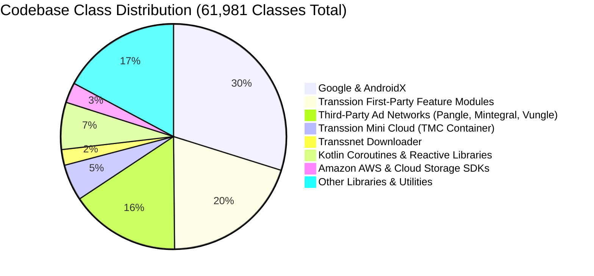

# Package Structure & Namespace Analysis

This document provides a comprehensive mapping of the 61,981 classes contained within MovieBox, categorizing code by first-party feature domains and third-party dependencies.

---

## 1. High-Level Namespace Distribution

---

## 2. First-Party Feature Packages (`com.transsion.*` & `com.community.oneroom.*`)

| Package Path | Class Count | Domain Responsibility |
| :--- | :--- | :--- |
| `com.community.oneroom` | 42 | Root application package, manifest anchors, and resource pointers. |
| `com.transsion.subroom` | 186 | Main application container (`SplashActivity`, `MainActivity`, app tabs). |
| `com.transsion.home` | 1,152 | Home page feeds, banners, categories, trending carousels, dynamic tabs. |
| `com.transsion.moviedetail` | 407 | Long-form VOD movie and series detail views, seasons, episodes, cast info. |
| `com.transsion.player` | 415 | `ORPlayer` multi-engine abstraction, resolution switches, subtitle bindings. |
| `com.transsion.shorttv` | 845 | ShortTV vertical micro-drama feed, episodic paywalls, coin deduction. |
| `com.transsion.shorttv_pugc` | 546 | Professional User-Generated Content dramas and creator profiles. |
| `com.transsion.ugcvideodetail` | 388 | TikTok-style vertical short video social feed, audio track reuse, likes. |
| `com.transsion.postdetail` | 1,241 | Social community post threads, discussions, rich text rendering, user tags. |
| `com.transsion.publish` | 274 | Creator studio for capturing, trimming, encoding, and publishing UGC videos. |
| `com.transsion.search` | 281 | Multi-facet search engine, trending rankings, autocomplete suggestions. |
| `com.transsion.member` | 410 | VIP membership packages, subscription validation, privilege gating. |
| `com.transsion.rewardscenter` | 284 | Gamified tasks, daily check-in rewards, coin collection systems. |
| `com.transsion.usercenter` | 761 | User profiles, watch history, offline favorites, user settings. |
| `com.transsion.transfer` | 592 | Wi-Fi Direct and local hotspot P2P movie sharing between devices. |
| `com.transsion.push` / `mpush` | 340 | Push notification dispatchers (FCM + Transsion proprietary push engine). |
| `com.transsion.api.gateway` | 128 | Network gateway interceptor, HMAC signature generator, time offset sync. |
| `com.transsion.baselib` | 335 | Foundation libraries: Room database DAOs, network models, coroutine utils. |

---

## 3. Dedicated Platform Subsystems

| Package Path | Class Count | Domain Responsibility |
| :--- | :--- | :--- |
| `com.transsnet.downloader` | 1,396 | High-resilience multi-threaded chunked range download engine. |
| `com.cloud.tmc` | 3,241 | Transsion Mini Cloud: V8 runtime, JSBridge, sandbox container. |
| `com.cloud.hisavana` | 1,073 | In-house ad mediation matrix, waterfall bidding, and AB experimentation. |

---

## 4. Injected Modding Classes

| Package Path | Class Count | Target Role |
| :--- | :--- | :--- |
| `Abdullah.hook` | 2 | Application subclass hooking `attachBaseContext`, dynamic reflection proxy on `IPackageManager`, signature & Google Play Store spoofing. |
| `Abdullah.loader` | 1 | Loads `libdexloader.so` via `System.loadLibrary`. |
| `Abdullah.hook$a` | 1 | Internal reflection helper class for signature injection. |

