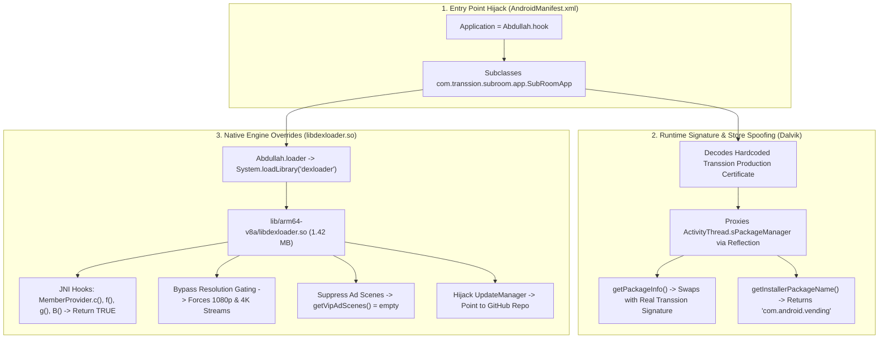

# Security Vulnerability & Injection Analysis

This document provides a deep forensic post-mortem of the modifications, hardcoded credentials, and security exposures discovered in the binary.

---

## 1. Modding & Injection Architecture Post-Mortem

The APK has been modified by third-party modder **Abdullah** (AN1 distribution). The injection alters three distinct layers:



---

## 2. Critical Security Findings

### 2.1 Remote Update Hijacking (`libdexloader.so`)
- **Evidence:** Embedded string in native library:
  ```
  https://raw.githubusercontent.net/abpremiumapps/MovieBox/refs/heads/main/MovieBox
  ```
- **Risk Level: CRITICAL**
- **Impact:** The official Transsion update system (`com.transsion.version.update.UpdateManager`) has been severed. The application queries an unverified personal GitHub repository for update manifests. Combined with `REQUEST_INSTALL_PACKAGES`, whoever controls the GitHub account can trigger silent download and execution of arbitrary APK payloads on user devices.

### 2.2 Hardcoded API Gateway Production Secret
- **Evidence:** Plain-text metadata in `AndroidManifest.xml`:
  ```xml
  <meta-data android:name="gateway_secret_online" android:value="76iRl07s0xSN9jqmEWAt79EBJZulIQIsV64FZr2O"/>
  <meta-data android:name="gateway_secret_test" android:value="Xqn2nnO41/L92o1iuXhSLHTbXvY4Z5ZZ62m8mSLA"/>
  ```
- **Risk Level: HIGH**
- **Impact:** The HMAC shared secret used by `GatewayInterceptor` to sign API requests to `https://i-api.aoneroom.com` and `https://api.hisavana.com` is completely exposed. Any third-party attacker can synthesize valid `x-tr-signature` headers and interact directly with Transsion's backend APIs without using the official client.

### 2.3 Client-Side Entitlement & Video Gate Bypass
- **Evidence:** Video resolution gates rely entirely on client-side boolean checks:
  ```java
  canNonSubscriberPlay(boolean isVip, int currentResolution, int targetResolution, PlayCallback callback)
  ```
- **Risk Level: HIGH**
- **Impact:** Stream segments are not protected by Widevine DRM. High-definition 1080p and 4K stream manifest URLs are returned in plain text to the client and played without server-side token validation. By hooking `MemberProvider.c()` to return `true`, all VIP resolution barriers are bypassed.

---

## 3. Recommendations for Security Hardening

1. **Implement Server-Side DRM (Widevine L1/L3):**
   - Encrypt video manifests and chunks with Widevine or AES-128. Issue temporary decryption keys only after validating server-side subscriber entitlement.
2. **Move Secrets Out of Manifest Metadata:**
   - Never store cryptographic signing secrets in `AndroidManifest.xml`. Use native C++ routines with control flow obfuscation (OLLVM) or hardware-backed Android Keystore attestation.
3. **Integrate Google Play Integrity API:**
   - Migrate from legacy local signature checks (`PackageManager.getPackageInfo`) to Google's server-verified Play Integrity API, validating cryptographic hardware attestation tokens on the backend before serving media catalogs.

